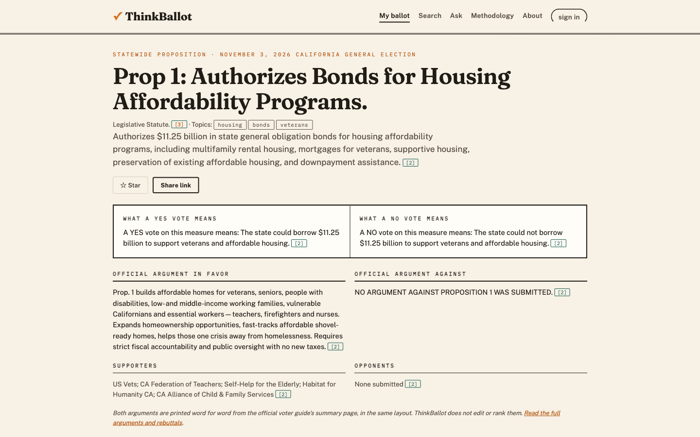

# ThinkBallot

**ThinkBallot turns a 100-page voter guide into a link you can trust: plain English, both sides equally,
straight from the official source.**

California's November 3, 2026 ballot has 14 statewide propositions. The official voter guide explains them
all, but it runs to well over a hundred pages. ThinkBallot gives every proposition one clear card and its own
shareable link, so young voters (and everyone else) can understand what they're voting on and drop a neutral,
sourced link into the group chat or neighborhood thread where opinions form.

Built by Abhinav Shirbhate in Sunnyvale, California.



## What it does

- **Your ballot:** enter an address or ZIP code to see your likely districts and all 14 statewide
  propositions. Star the ones you care about, and track how many you've read until your ballot is ready.
- **One card per proposition:** official summary, what a YES vote means and what a NO vote means side by
  side, the official arguments for and against side by side, supporters and opponents, the fiscal effect,
  and the Legislative Analyst's full analysis. Every field links to the exact official page.
- **Ask:** ask a question about a proposition. Answers come only from its official text, quote it, and are
  checked by **Bias Buster** before you see them. "How should I vote?" always gets the same answer: that's
  your call.
- **Search:** full-text search over the official text, with topic filters.
- **Community:** sign in to discuss a proposition (post-moderated, viewpoint-neutral rules) or submit a
  fact with a source link. Facts are published only after people who lean YES and people who lean NO both
  rate them helpful, and a moderator reviews them. The community zone is visibly separate and can never
  change the official card.

## How it stays neutral

1. **Official sources only:** the California Secretary of State's Official Voter Information Guide and the
   Legislative Analyst's Office.
2. **Their words, not ours:** the extraction system (`pipeline/extract/`) cuts each field out of the official page by code.
   No AI writes the cards.
3. **Verified before publishing:** `scripts/seed.py --live` refuses to load the data unless every field
   appears word for word on its live official page (154 of 154 fields pass).
4. **Both sides, equally:** YES always before NO, same layout, same styling, no partisan colours.
5. **Bias Buster** checks every AI answer and every label ThinkBallot writes: quote check (every point must
   quote the official text), number check, loaded-word check, YES/NO balance check, then an AI neutrality
   review whose edits go through the same checks again. If the review can't run, the answer is held back.
6. **Privacy:** only the ZIP code is used for districts; addresses and questions are never stored or logged.

## How it's built

Seven small services in one Python process. They talk to each other only over HTTP, so any of them can move
to its own server later.

| Service | Job |
|---|---|
| `web` | The pages (Flask templates, a little JavaScript) |
| `ballot` | Proposition data from SQLite |
| `geo` | ZIP code to likely districts |
| `search` | Full-text search and topic filters |
| `ask` | Grounded Q&A through OpenRouter |
| `bias` | Bias Buster |
| `community` | Accounts, discussion and community facts, with its own separate database |

```
Browser → web ─┬→ ballot → SQLite (official data, verified)
               ├→ geo, search
               ├→ ask → ballot, OpenRouter, bias
               └→ community → its own SQLite, bias
```

## Run it

```
python3 -m venv .venv
.venv/bin/pip install -r requirements.txt
echo "OPENROUTER_API_KEY=your-key" > .env      # for Ask; use TB_AI_PROVIDER=stub to run without AI
.venv/bin/python -m pipeline.crawler.crawl       # fetch official pages into data/raw (see below)
.venv/bin/python -m pipeline.extract.run         # extract measures from the raw store
.venv/bin/python scripts/seed.py --live         # verify every field, then load it
.venv/bin/python run.py                          # http://127.0.0.1:8000
.venv/bin/python -m pytest                       # tests
```

To make an account a moderator: `.venv/bin/python scripts/make_moderator.py <email>`.

### Prepared answers to the suggested questions

The suggested questions under every Ask box are answered in advance, so they come back at once. Only those
fixed questions are ever stored (in `ask_cache.sqlite3`, next to the community database); a question a
voter types is never stored. Each prepared answer is keyed by the measure, the question, a SHA-256 of the
official text sent to the model, and both models; the Bias Buster version is stored with it. When any of
these change, the old answer is simply not used. Every time one is shown, Bias Buster re-checks its quotes
word for word against the current official text (no AI), and the page says it was prepared in advance.
A prepared answer counts against the per-visitor limit, but not against the site-wide AI limit.

Answers are kept as voters ask, and `scripts/warm_ask_cache.py` prepares the rest: one question at a time,
in-process (no HTTP, no rate limits), skipping those already prepared, so it can be stopped and re-run.
Blocked answers and errors are not kept. It stops after 5 errors in a row (e.g. the model's daily limit);
run it again later. Locally: `.venv/bin/python scripts/warm_ask_cache.py`.

On the server, after a deploy that changes official text or models, run it as the service account, with the
release's venv and the service's env file (the same `/path/to/service.env` that systemd loads, so it reads
the same API key, never printed). From your laptop:

```
ssh the deploy account@the server 'cd / && sudo -n -u thinkballot bash -c "cd /opt/thinkballot/current && nohup .venv/bin/python scripts/warm_ask_cache.py --env-file /path/to/service.env >> /var/lib/thinkballot/warm_ask_cache.log 2>&1 &"'
ssh the deploy account@the server 'sudo -n -u thinkballot tail -n 5 /var/lib/thinkballot/warm_ask_cache.log'
```

Expected: one line per question, `warm measure=<id> q=<n> status=answered|refused|blocked|cached <s> s`,
ending with `warm done: 0 question(s) still without a prepared answer` (about 1 to 2 hours for every
measure; a non-zero count means run it again). Stop it:
`ssh the deploy account@the server 'sudo -n -u thinkballot pkill -f warm_ask_cache.py'`. Undo (the site then answers
every question live): `ssh the deploy account@the server 'sudo -n -u thinkballot rm -f /var/lib/thinkballot/ask_cache.sqlite3 /var/lib/thinkballot/ask_cache.sqlite3-wal /var/lib/thinkballot/ask_cache.sqlite3-shm'`.

## Data sources

- California Secretary of State, Official Voter Information Guide, November 3, 2026:
  https://voterguide.sos.ca.gov/propositions/
- Analyses by the Legislative Analyst's Office, published in the same guide.
- Santa Clara County Registrar of Voters, List of Local Measures (November 3, 2026).
- Every source page used is stored byte for byte in `data/raw/` with its crawl metadata.

## What I learned

*(Abhinav: rewrite this in your own words.)*

## What's next

- County, city and school district measures, starting with Santa Clara County.
- Candidate races with equal, sourced candidate cards.
- Exact districts from an official address lookup instead of ZIP codes.
- Email verification and notifications for starred propositions.
- More languages: the official guide is published in ten.

## License

GNU Affero General Public License v3. Copyright © 2026 Abhinav Shirbhate. See `LICENSE` and `NOTICE`;
contributions are welcome through pull requests (see `CONTRIBUTING.md`).

## Data pipeline: crawling and extraction

Two separate systems that share only the raw store (`data/raw/`):

1. **Crawler** (`pipeline/crawler/`). `python -m pipeline.crawler.crawl` fetches the sources listed in
   `pipeline/sources.json`. It identifies itself honestly, obeys robots.txt, waits between requests and
   retries with backoff. It stores every page byte for byte, named by its SHA-256, plus crawl metadata
   (run, URL, status, headers, parent page, unchanged/blocked) in `data/raw/crawl.sqlite3`. When a site
   refuses automated clients, the crawler records the block and never works around it. Such pages can enter
   the store only through a supervised browser capture (`python -m pipeline.crawler.capture`), which is
   labelled as such.
2. **Extraction** (`pipeline/extract/`). `python -m pipeline.extract.run` reads only the raw store. It runs
   one extractor per source layout (the state voter guide; Santa Clara County's list of local measures) and
   writes `data/extracted/<source>.json` and `data/measures.json`. Every field records its page, the raw
   object it was cut from, when it was fetched, and whether it was fetched by the crawler or captured.

Then `scripts/seed.py --live` verifies every field word for word before anything is published.
Coverage today: all 14 statewide propositions; 20 Santa Clara County local measures (ballot questions word
for word, official PDFs linked).
